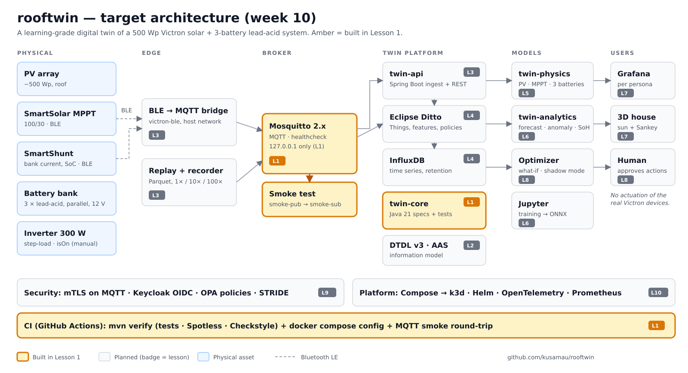
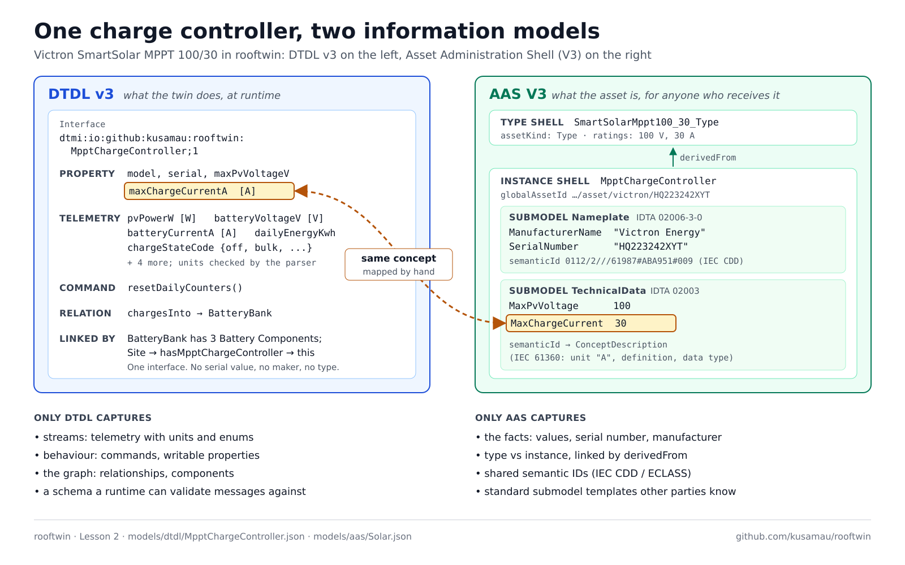

# rooftwin

A simple digital twin for a simple home solar system.

`rooftwin` is a **learning-grade** digital twin of a real, small off-grid PV installation: a 615 Wp
panel, a Victron SmartSolar MPPT 100/30, a Victron SmartShunt, three mismatched lead-acid batteries
in parallel and a 300 W inverter. It is built in public, one step per week, as part of a 10-week
personal deep dive into digital twin technology.

It is not a product and not production-grade. It is a place to get the fundamentals right on a
system small enough to understand completely: information models, telemetry, physics, ML, safe
prescriptive loops, security and operations.



## Status

| Lesson | Topic | State |
|---|---|---|
| 1 | Foundations, repo skeleton, MQTT smoke test | ✅ |
| 2 | Information models (DTDL v3, AAS), validators, Java mirror | ✅ this commit |
| 3 | BLE → MQTT bridge, replay mode | planned |
| 4 | Eclipse Ditto + InfluxDB | planned |
| 5 | Physics models and calibration | planned |
| 6 | Forecasting, anomaly detection, state of health | planned |
| 7 | Dashboards, 3D house, energy Sankey | planned |
| 8 | What-if scenarios and shadow-mode recommendations | planned |
| 9 | Security: mTLS, OIDC, OPA, threat model | planned |
| 10 | k3d deployment, observability | planned |

## Quick start

Requirements: Docker with Compose v2, Git. A local JDK 21 and Maven 3.9 are optional, since
everything can run in containers.

```bash
# Build and test (Java 21, JUnit 5, Spotless, Checkstyle)
mvn verify                       # or, with Docker only:
ops/scripts/mvn-docker.sh verify

# Start the MQTT broker and wait until it is healthy
docker compose -f compose/docker-compose.yml up -d --wait

# Smoke test: one message published and received on smoke/test
smoke/run-smoke.sh

# Validate the information models (DTDL v3 + AAS) in containers, as CI does
ops/scripts/validate-models.sh
```

The information model is described in [`docs/information-model.md`](docs/information-model.md);
why DTDL, AAS and Ditto each have a role is in [`docs/architecture-choice.md`](docs/architecture-choice.md).



If formatting fails the build, run `mvn spotless:apply` (or `ops/scripts/mvn-docker.sh spotless:apply`).

## Repository layout

```
apps/            Java modules: twin-core (domain model), twin-api, twin-physics,
                 twin-analytics, twin-ui-backend
compose/         docker-compose.yml (+ profile overlays from Lesson 3)
docker/          Dockerfiles for non-Java containers (model validators; BLE bridge and replay from L3)
models/          DTDL v3 interfaces, AAS environment (+ generator); ONNX from L6
notebooks/       Jupyter notebooks (training only)
data/            Recorded telemetry and replay sets (gitignored)
ops/             Mosquitto config, scripts; later Grafana, OPA, PKI, Helm
smoke/           Lesson 1 smoke test
docs/            Architecture notes per lesson
```

## Design principles

- **Docker-first.** No host installs beyond Docker, Git, a JDK and an IDE.
- **Honest scope.** The twin observes and recommends. It never actuates the real hardware.
- **Live and replay.** From Lesson 3 every feature works on recorded data, so development does not
  depend on the weather.
- **The battery bank is three batteries, not one.** Mismatch, ageing and the cable-hop topology are
  modelled explicitly, not averaged away.

## Docs

- [Conceptual model](docs/conceptual-model.md): five-dimension mapping, observable quantities,
  model / shadow / twin, maturity target.

## License

MIT, see [LICENSE](LICENSE).
